# MB0205 ESP32 S3 Pro 开发板

## 1. 资料下载

Windows系统驱动下载：[资料(代码与USB驱动文件)](./资料(代码与USB驱动文件).7z)

## 2. 介绍

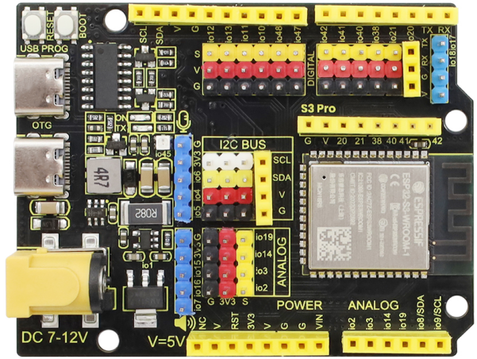

ESP32S3 PRO开发板是基于ESP32-S3-N16R8模组设计的，这款开发板与常见开发板相比增加了电流检测和SD卡挂载功能，并且将绝大多数引脚通过排针排母引出，板载的DC-DC芯片和LDO芯片能够满足常见模组的电源需求，方便开发者拓展额外功能。

## 3. 规格参数

- **工作电压**：DC3.3V，DC5V
- **输入电压**：DC接口7-12V，USB接口5V
- **空载运行电流**：80mA
- **最大输出电流**：1.5A
- **模组**：ESP32-S3-WROOM-1
- **FLASH**：16MB
- **时钟频率**：240MHz
- **SD卡**：支持 MicroSD/TF 形态
- **尺寸**：69mm*54mm

## 4. 接口描述

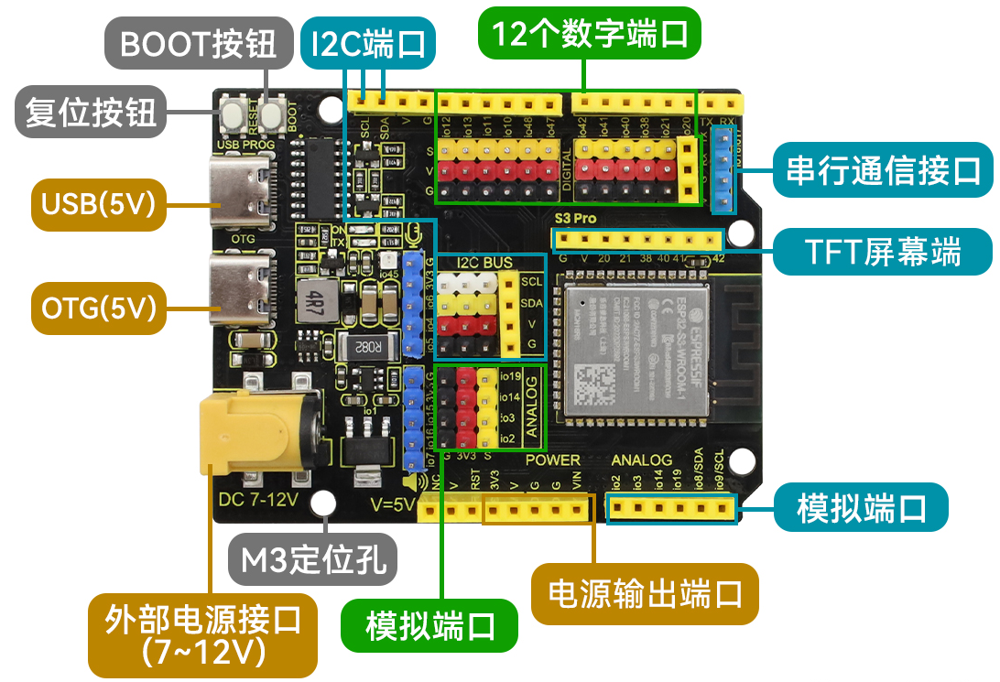

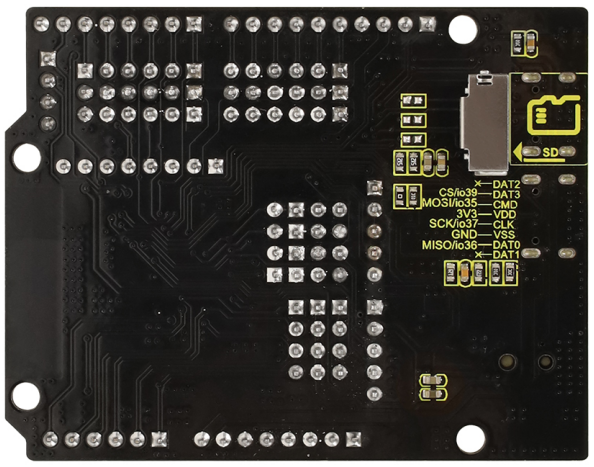

具体引脚功能可以参考 [ESP32-S3 Series Datasheet](https://documentation.espressif.com/esp32-s3_datasheet_en.pdf) 2.2章节Pin Overview。
开发板外设与引脚连接如下：

| 外设 | 名称 | IO |   
|:-------:|:----:|:---:|
| RGB     | DIN  | io45      | 
| INA180  | OUT  | io1       | 
| SD卡 | DAT3 | io39/CS   | 
| SD卡 | CMD  | io35/MOSI | 
| SD卡 | SCK  | io37/SCK  | 
| SD卡 | DAT0 | io36/MISO |
| USB OTG | D+   | io20 |
| USB OTG | D-   | io19 |

## 5. Arduino IDE开发环境设置

### 5.1 Windows 系统

**特别提醒：本教程采用的 Arduino IDE 版本是 2.3.10 。如果是其他版本的话，不能保证本教程提供的示例代码能编译和上传成功。** 

#### 5.1.1 Arduino IDE下载 

我们先到Arduino官方的网站：[Software | Arduino](https://www.arduino.cc/en/software/) 下载 Arduino IDE。

Arduino 软件有很多版本，有Windows，Mac，Linux系统的（如下图），而且还有过去老的版本，你只需要下载一个适合自己计算机系统的版本即可。

这里是以下载 **Windows Win 10 or newer(64-bit)** 为例，你也可以根据自己所需，选择下载 **Windows ZIP file**。选择如下图。

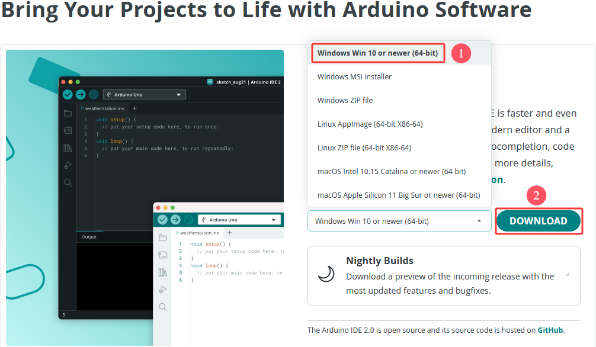

这里我们以Windows系统的为例给大家介绍下载和安装的步骤。Windows系统的也有两个版本，一个版本是安装版：Windows Win 10 or newer(64-bit) ；另一个是下载版：Windows ZIP file，是不用安装，直接下载文件到电脑，解压缩就可以用了。

#### 5.1.2 Arduino IDE安装

1\. 保存从软件页面下载的.exe文件到硬盘驱动器，然后简单地运行该文件.

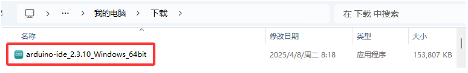

2\. 阅读许可协议并同意.

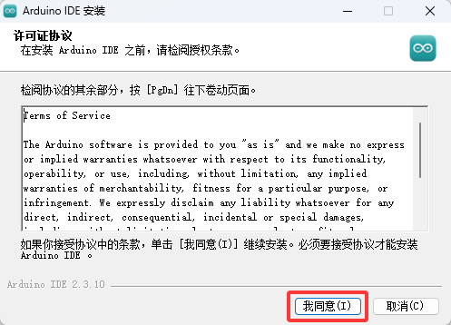

3\. 选择安装选项.

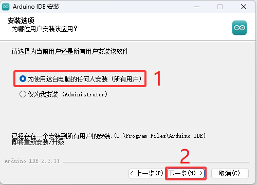

4\. 选择安装位置.

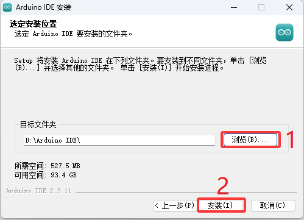

5\. 单击 "完成" 并运行Arduino IDE

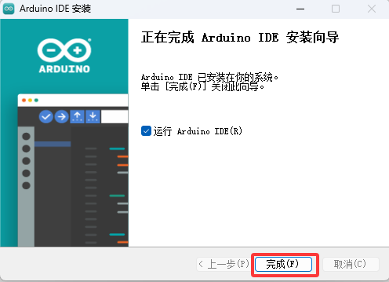

### 5.2 MacOS 系统

#### 5.2.1 Arduino IDE下载

我们先到Arduino官方的网站：[Software | Arduino](https://www.arduino.cc/en/software/) 下载 Arduino IDE。

不同的系统，需要下载不同的Arduino IDE，下载方式和 Windows 类似。这里是以下载 **macOS Intel 10.15 Catalina or newer(64-bit)** 为例，你也可以根据自己所需，选择下载 **macOS Apple Silicon 11 Big Sur or newer(64-bit)**。选择如下图。

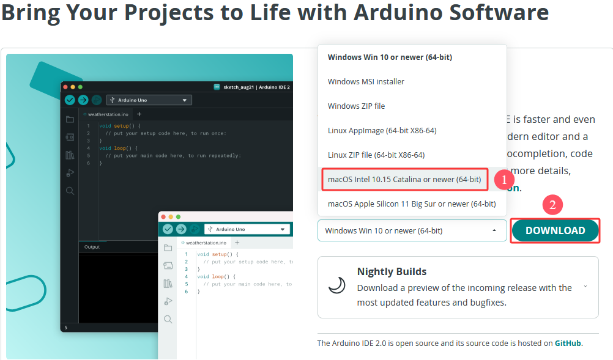

#### 5.2.2 Arduino IDE安装

Arduino IDE下载之后，双击下载的`arduino_ide_xxxx.dmg`文件并按照说明将 **Arduino IDE.app** 复制粘贴到 **Applications** 文件夹，几秒钟后您将看到 Arduino IDE 安装成功.

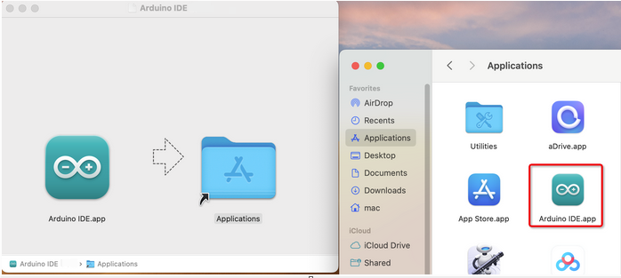

### 5.3 Linux 系统

#### 5.3.1 Arduino IDE下载

我们先到Arduino官方的网站：[Software | Arduino](https://www.arduino.cc/en/software/) 下载 Arduino IDE。

不同的系统，需要下载不同的Arduino IDE，下载方式和Windows类似。这里是以下载 **Linux Applmage(64-bit X86-64)** 为例，你也可以根据自己所需，选择下载 **Linux ZIP file(64-bit X86-64)**。选择如下图。

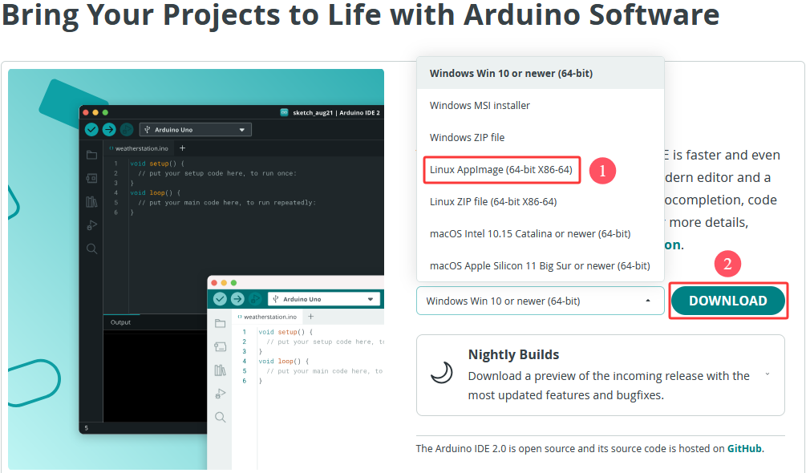

#### 5.3.2 Arduino IDE安装

关于在 Linux 系统上安装 Arduino IDE 2 的教程，请参考链接：[https://docs.arduino.cc/software/ide-v2/tutorials/getting-started/ide-v2-downloading-and-installing/#linux](https://docs.arduino.cc/software/ide-v2/tutorials/getting-started/ide-v2-downloading-and-installing/#linux)

### 5.4 设置Arduino IDE语言

⚠️ **特别提醒：Windows系统、MAC系统等不同系统，Arduino IDE语言设置方法差不多，可以参考。**

1\. 首先打开Arduino IDE.

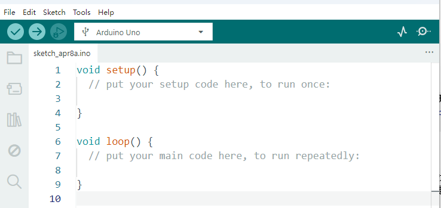

2\. 点击 “**File** ——>**Preferences...**”，在 **Preferences** 对话框中，单击 “**English**” 按钮选择 “**中文(简体)**”，然后单击 “**OK**”.

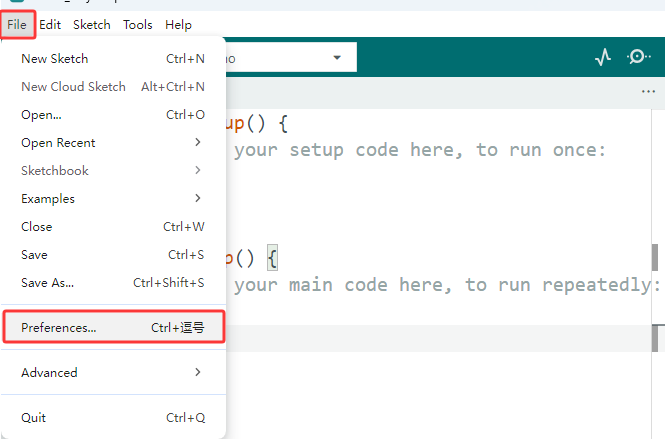

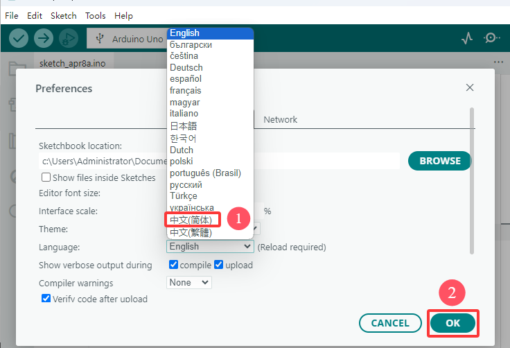

3\. 这样，Arduino IDE的语言切换完成了，Arduino IDE的语言为中文(简体)。

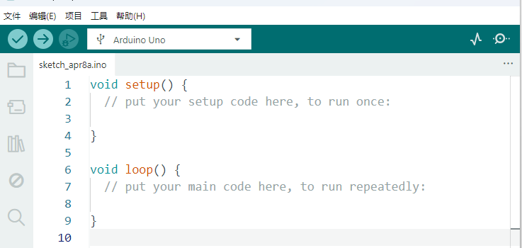

### 5.5 Arduino IDE说明

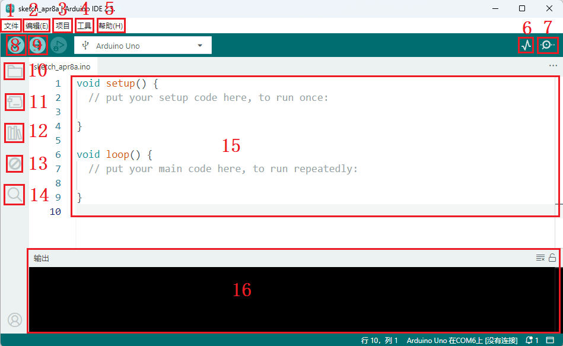

1\. “文件”：列表里面的功能有新建项目，打开程序，打开最近使用的代码，打开示例代码，关闭IDE，保存代码，首选项，高级设置等。

2\. “编辑”：列表里面的功能有复制，粘贴，自动格式化，字体大小等这个一般都是使用快捷键进行操作。（建议坚持使用快捷键，接触多了就水到渠成了）。

3\. “项目”：列明里面的常用功能有验证\编译代码，上传代码，导入库等。

4\. “工具”：列表里面的常用功能有开发板选择，端口选择，这两个很重要。

5\. “帮助”：点击这个可以查看IDE版本已经官方的参考文件。

6\. “串口绘图仪”：它会将串口的数据以折线图的样式显示出来。

7\. “串口监视器”：可以将我们需要查看的数据在这里进行打印显示。

8\. 验证程序按钮。

9\. 验证并上传程序按钮。

10\. “项目文件夹”：可以新建项目，还可以只有arduino Cloud进行同步和编辑。

11\. “开发板管理器”：可以添加或删除开发板。

12\. “库管理”：就要添加和删除库。

13\. “调试”：可以对代码进行监视与断点调试。

14\. 搜索框。

15\. 代码编辑区。

16\. IDE提示区（上传代码报错或成功）和串口监视器显示区

至此Arduino IDE说明教程结束了，请学习如何给Arduino IDE添加库文件，如果没有添加库文件IDE会报错。

### 5.6 给Arduino IDE安装库文件(**重要**)

⚠️ **特别提醒：Windows系统、MAC系统等不同系统，安装库文件的方法差不多，可以相互参考；这里是以Windows系统为例。**

#### 5.6.1 什么是库文件

库是代码的集合，使您可以轻松地连接到传感器、显示器、模块等。

例如：LiquidCrystal_I2C库使LCD1602显示变得容易，Internet上有数百个其他库可供下载。参考中列出了内置库和手动添加的库。 

在编译代码或上传代码时，如果出现报错信息 “No such file or directory”，那说明缺少相应的库文件。

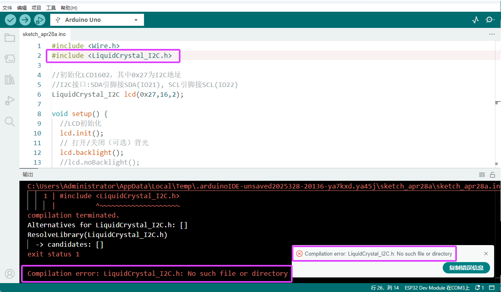

#### 5.6.2 如何安装库文件

在这里，将为您介绍最简单的添加库的方法。我们是以添加 **ESP32Servo** 库文件为例。

1\. 首先，打开Arduino IDE.


2\. 然后，依次点击IDE左上角的 “**项目” > “导入库” > “添加 .Zip 库...”**

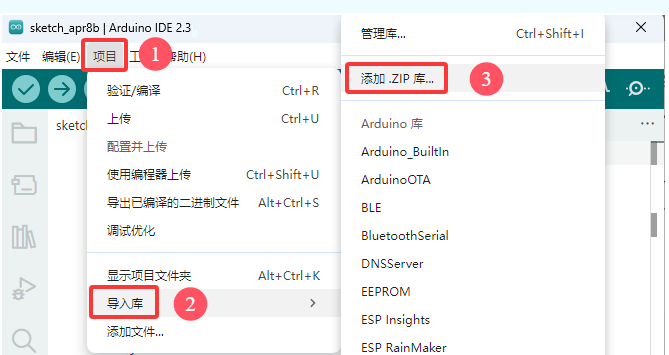

3\. 导航到库文件所在的目录（在 `资料下载` 中下载的文件解压，这里是以资料下载到电脑桌面上为例），打开文件夹 `Arduino_库文件`，然后选择 `ESP32Servo.zip` 文件，点击 “**打开**” 按钮。

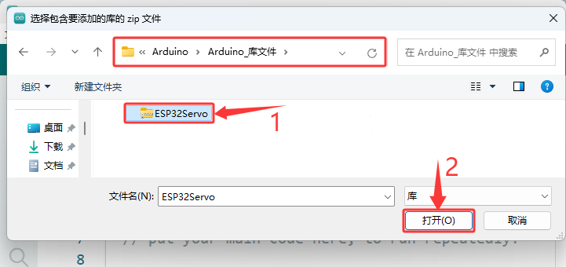

4\. 安装完成后，你将收到一条通知（已从ESP32Servo.zip存档成功安装库），同时输出框会显示 “**Library installed**”，确认该库已成功添加到Arduino IDE中。下次需要使用此库时，你不需要重复安装过程。

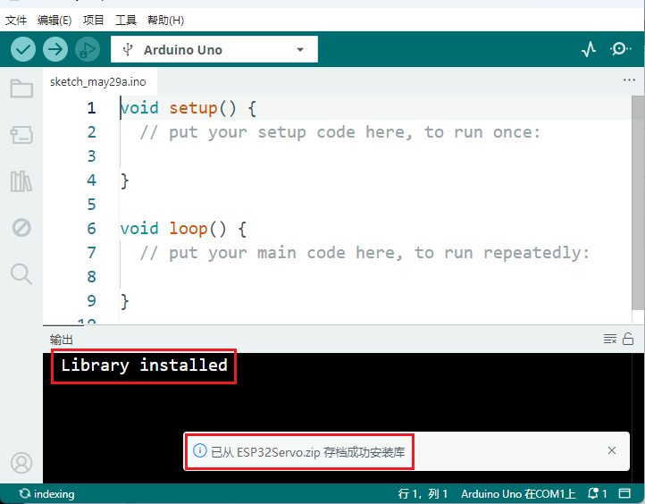

5\. 重复前面相同的添加过程(方法)来添加其他(剩余)的库文件，这里就不一一重复讲解了。

### 5.7 安装 ESP32 开发板(**重要**)

⚠️ **特别提醒：由于网速原因，需要安装时间较长，安装过程可能会出现下载失败的情况，需要多尝试几次安装。**

#### 5.7.1 Windows系统

我们发现在arduino IDE “**工具**”下的 “**开发板**” 中找不到ESP32开发板的选项，这是因为我们没有添加ESP32开发板，接下来我们一起来为Arduino IDE添加ESP32开发板吧!

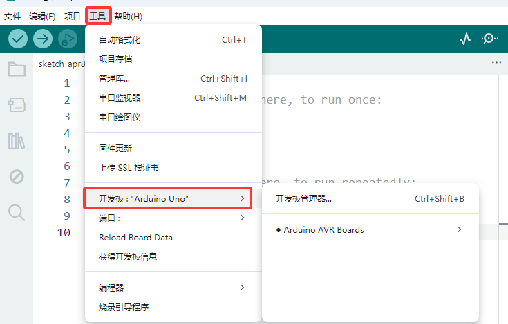

**安装ESP32开发板步骤如下：**

1\. 首先打开Arduino IDE.

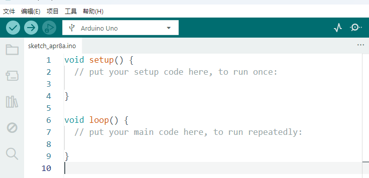

2\. 点击“**文件** ——>**首选项...**”，在**其他开发板管理器地址**中，将ESP32开发板的链接：`https://espressif.github.io/arduino-esp32/package_esp32_index.json` 复制粘贴至文本框中，然后单击 “**确定**”。

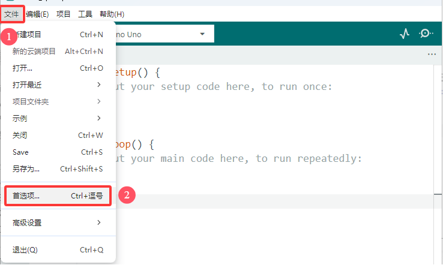

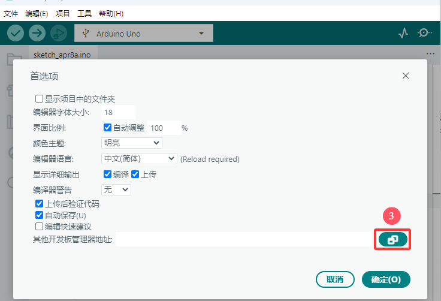

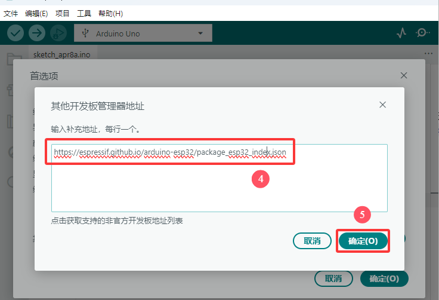

3\. 再点击 “**确定**”。

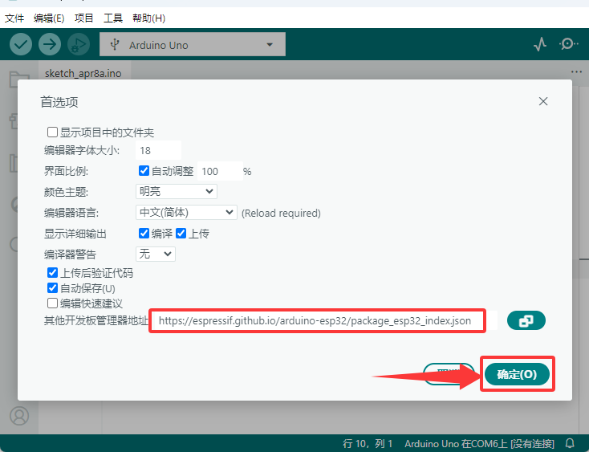

4\. 点击左边的开发板小图标，打开开发板选项。

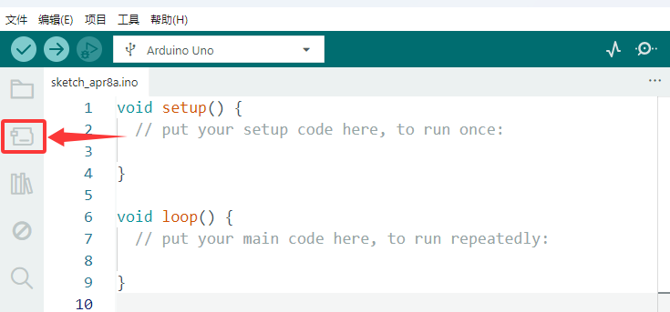

5\. 在开发板搜索框中，搜索 “**ESP32**”，点击安装最新版本，右下角可以看到开发板安装进度，等待几分钟安装完成。**安装过程中请保持网络稳定，如安装失败，请重复以上步骤，重新安装开发板即可。**

⚠️ **<span style="color: rgb(255, 76, 65);">注意：</span> 本教程使用的是 ESP32 3.2.1 版本的ESP32开发板，请保持一致，以免出现代码不兼容情况。**

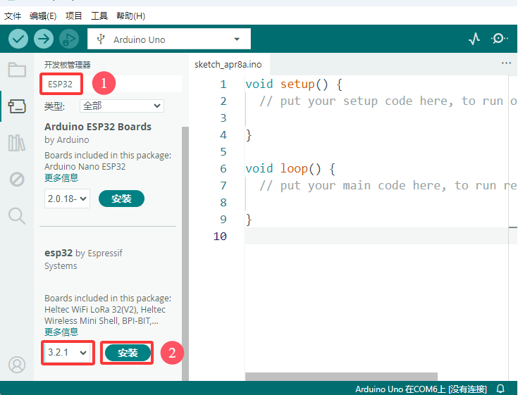

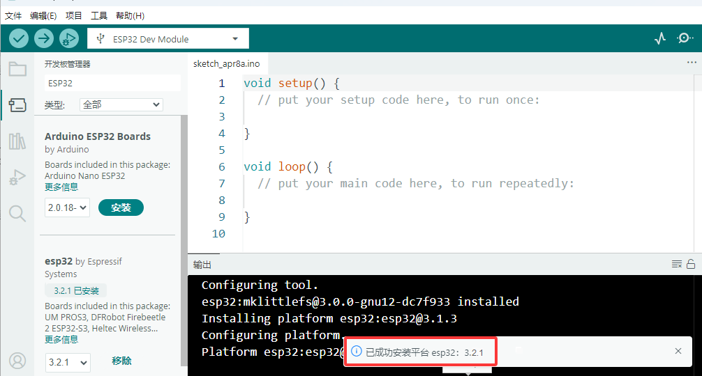

⚠️ **<span style="color: rgb(255, 76, 65);">特别提醒：假如，由于网络问题实在是下载安装不了ESP32开发板，我们也提供有ESP32开发板的压缩包，ESP32开发板的压缩包下载地址：</span>** [https://pan.baidu.com/s/10mfU2_aNru2dizP0vAFXlw?pwd=95ih](https://pan.baidu.com/s/10mfU2_aNru2dizP0vAFXlw?pwd=95ih) 

**提取码：95ih**

**压缩包下载后解压，把解压后的ESP32开发板文件夹按照以下路径添加。ESP32开发板一般需要存放于以下路径，才能说明ESP32开发板安装好。**

- **Windows 系统**：路径为C:\Users\你的用户名\AppData\Local\Arduino15\packages 。其中，AppData 目录为隐藏目录，需要点击文件夹菜单栏的 **工具->文件夹选项->查看->选择显示隐藏的文件、文件夹和驱动器**，然后点击 “**确定**” 保存。

⚠️ **提醒：** 上面路径中 “**你的用户名**” 是指你安装电脑时设置的用户名字，如果没有设置，一般都是Administrator。

- **MacOS 系统**：位于~/Library/Arduino15/packages。Library 也是一个隐藏文件夹，你可以通过在 “**访达**” 中使用快捷键Command + Shift + G ，然后输入该路径来访问。

- **Linux 系统**：存于~/.arduino15/packages 。

6\. 安装成功后，重新启动 Arduino IDE，然后点击“**工具**” → “**开发板:**”，这样就可以看到安装成功的ESP32开发板。安装成功如图：

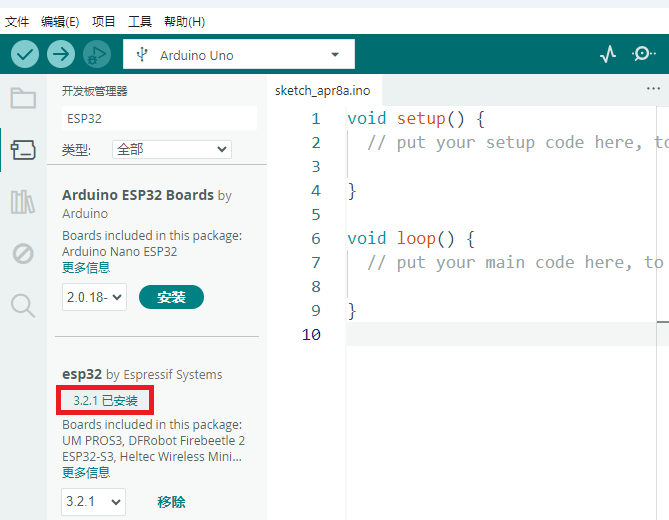

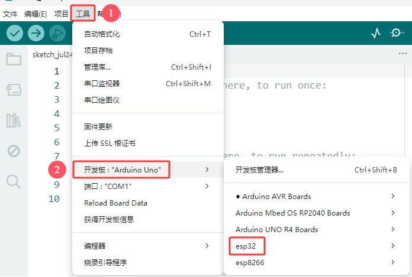

#### 5.7.2 MAC系统

上面已经学习了怎么下载ArduinoIDE，那下面就要在Arduino IDE上安装ESP32开发板，请执行以下步骤：

**安装ESP32开发板步骤如下：**

1\. 首先打开Arduino IDE，点击“**Arduino IDE** ——>**首选项...**”，在**其他开发板管理器地址**中，将ESP32开发板的链接：`https://espressif.github.io/arduino-esp32/package_esp32_index.json` 复制粘贴至文本框中，然后单击 “**确定**”。

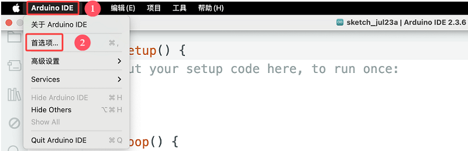

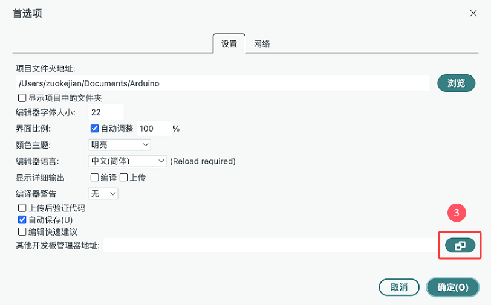

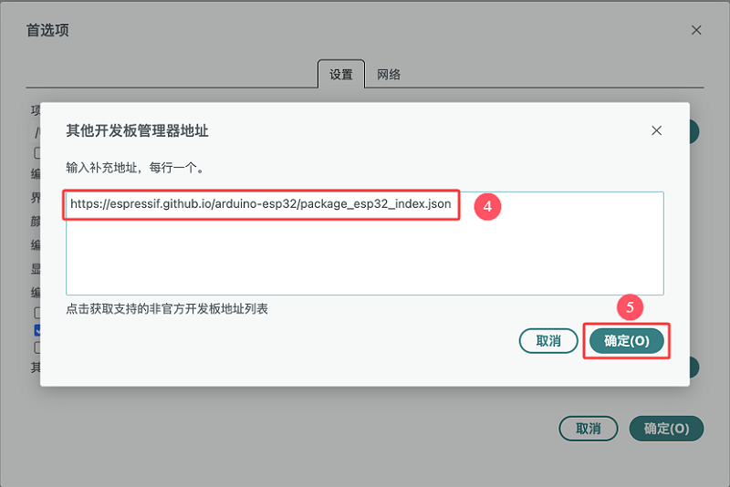

3\. 再点击 “**确定**”。

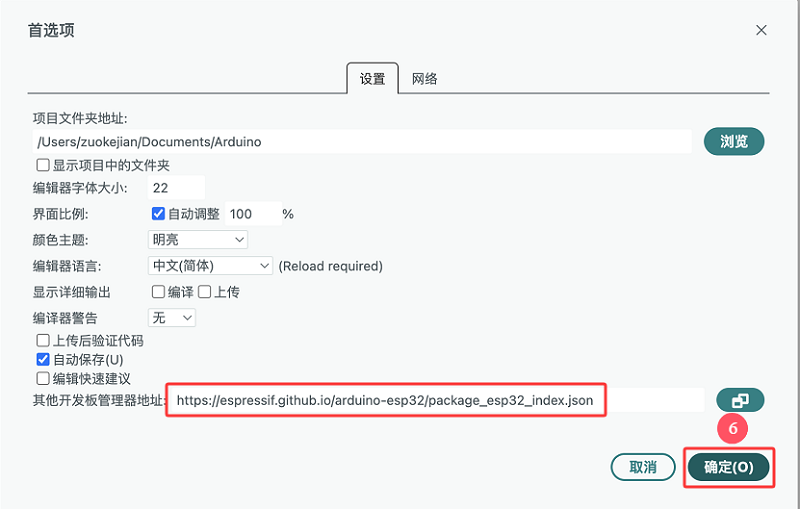

4\. 点击 “**工具**” ——> “**开发板**”  ——> “**开发板管理器...**”。

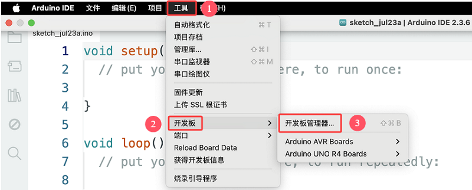

5\. 在开发板搜索框中，搜索 “**ESP32**”，点击安装最新版本，右下角可以看到开发板安装进度，等待几分钟安装完成。**安装过程中请保持网络稳定，如安装失败，请重复以上步骤，重新安装开发板即可。**

⚠️ **<span style="color: rgb(255, 76, 65);">注意：</span>本教程使用的是 ESP32 3.2.1 版本的ESP32开发板，请保持一致，以免出现代码不兼容情况。**

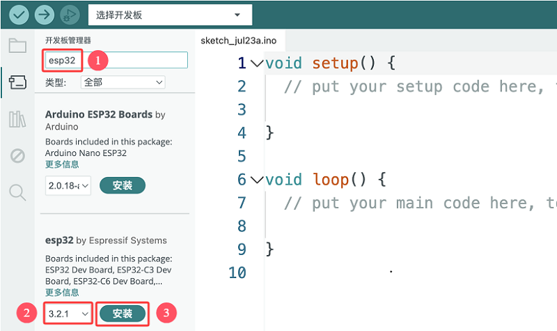

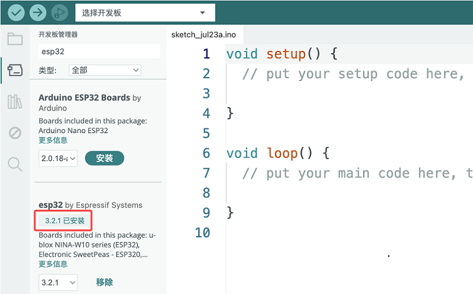

6\. 安装成功后，重新启动 Arduino IDE，然后点击“**工具**” → “**开发板:**”，这样就可以看到安装成功的ESP32开发板。安装成功如图：

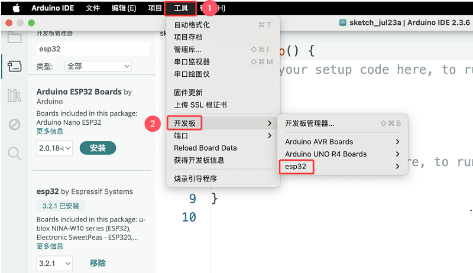

### 5.8 使用Arduino IDE上传第一个程序

先将ESP32S3 Pro开发板通过USB线连接到电脑。

打开Arduino IDE, 选择对应的开发板型号 (ESP32S3 Dev Module)。

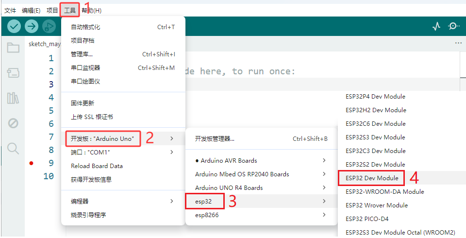

选好ESP32S3开发板后，选择开发板的COM口，开发板安装完驱动后会显示一个COM端口，如果你不知道是哪个，可以进入你电脑的设备管理器中进行查看，如下图：（如果你有很多COM端口，你不知道是哪个就可以拔掉开发板看哪个消失了，然后再插上开发板消失的COM口又会显示出来，如果没有COM就请检查是否有安装好开发板驱动）

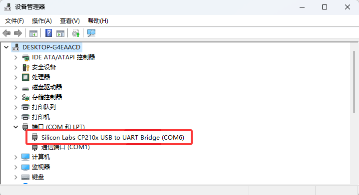

从图中可知，COM端口是COM6，在 “**工具**” 列表中选择 “**端口**” 然后选择 “COM6”。

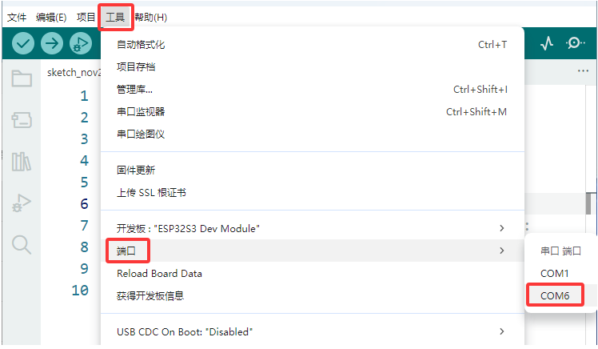

连接上ESP32S3 Pro开发板后，这两个地方都会显示已连接的标志，然后添加代码：这里我们提供一个示例代码，代码功能是在串口监视器中每隔一秒钟打印一次 “Hello Keyes!”

将下面的代码复制粘贴到Arduino IDE的代码区

```c
/*
  keyes 
  打印 “Hello Keyes!”
  http://www.keyesrobot.com
*/
void setup() {  
    // 把你的设置代码放在这里，运行一次:
    Serial.begin(9600);  //设置串口波特率为9600
}

void loop() {  
    // 将主代码放在这里，以便重复运行:
    Serial.println("Hello Keyes!");  //串口打印
 	delay(1000);  //延迟1秒
}
```

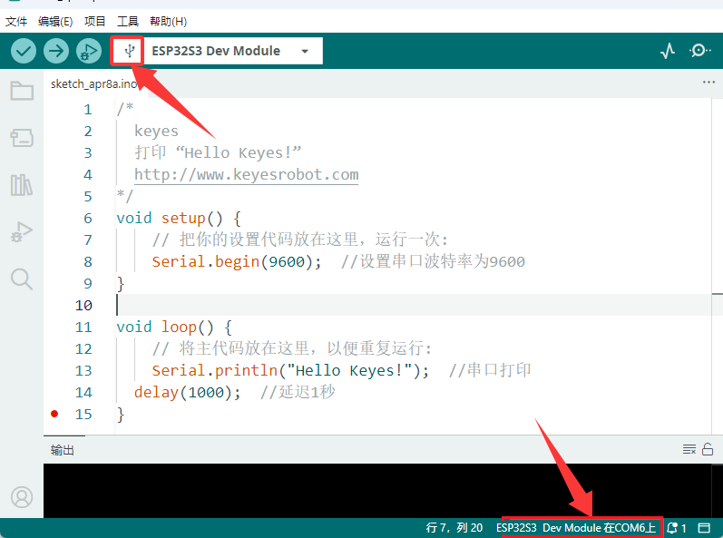

然后点击  编译并上传代码，上传成功后IDE也会有两个提示，如图：

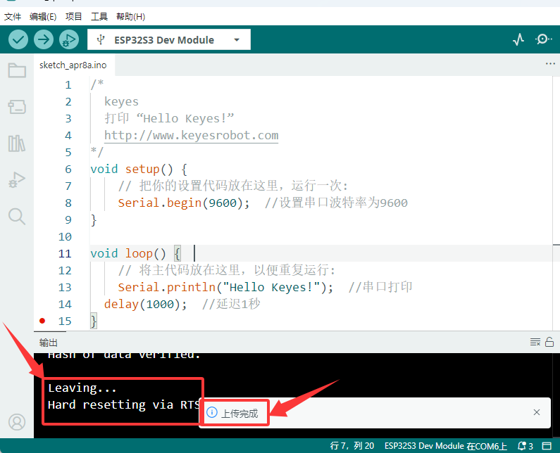

最后，点击 “串口监视器” 图标  便能打开串口监视器，设置波特率为 **9600**，就能看到串口打印字符串 “**Hello Keyes!**”

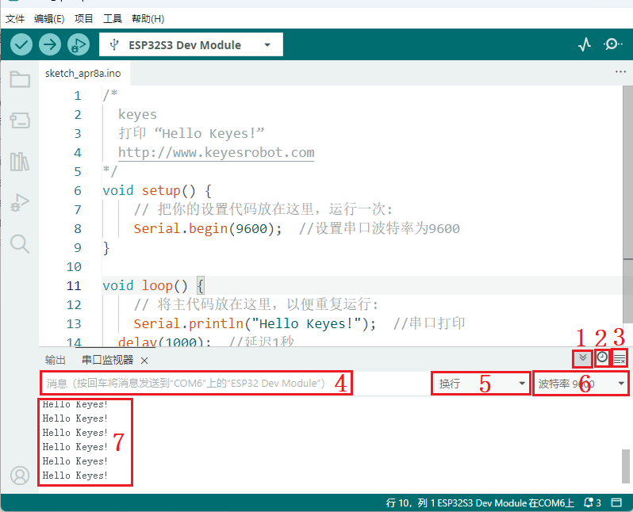

1\. 切换自动滚动：设置打印窗口是否跟随打印.

2\. 切换时间戳：设置是否显示打印时间。

3\. 清除输出 / 清空输出：清除打印窗口中的数据。

4\. 串口输入框。

5\. 串口发送格式。

6\. 设置波特率，点击即可选择需要的波特率。

7\. 打印窗口。

### 5.9 Arduino基础代码介绍

更多详细解释请参考官方链接：[Language Reference | Arduino Documentation](https://docs.arduino.cc/language-reference/)

## 6. CH340驱动安装(选读部分)

本部分非必读部分，仅在ESP32S3 Pro主控板无法被电脑识别时使用，如果已经识别可直接跳过！！！

**注意：** 如果ESP32S3 Pro主控板在Arduino、Mixly或者KidsBlock(Scratch)教程中无法被识别，请先检查ESP32S3 Pro主控板是否连接到位并且连接电脑其他USB端口重新测试，如果依旧不行再开始以下驱动安装步骤

### 6.1 Windows系统

Windows系统驱动下载：[Windows驱动](./Windows.7z)

1、将ESP32S3 Pro主控板连接到电脑（如图）。

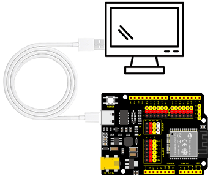

2、打开“**设备管理器**”。

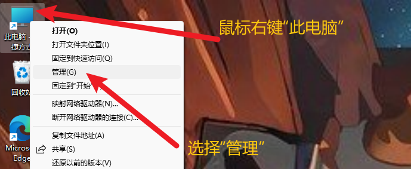

3、检查驱动是否已经安装。

情况一：驱动安装完成，请跳过驱动安装教程，进行下一步学习。

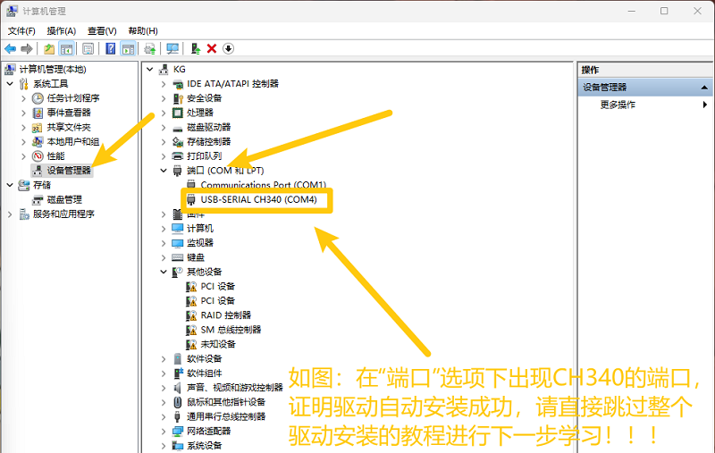

情况二：驱动没有安装，请进行以下安装教程进行手动安装驱动。

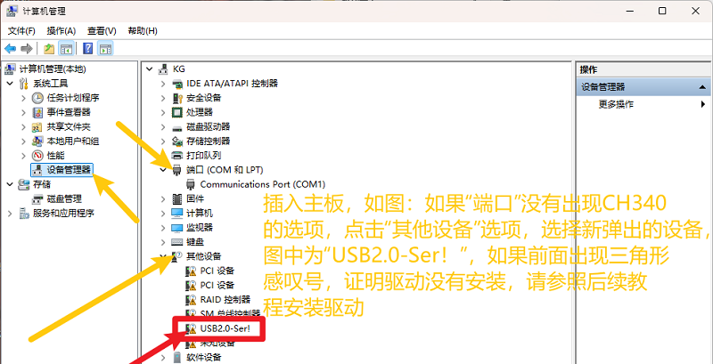

4、驱动安装

（1）. 鼠标右击 "**USB2.0-Ser**"，在弹出框中选择 “**更新驱动程序(P)**”。


（2）. 点击选择 “**浏览我的电脑以查找驱动程序(R)**”。


（3）. 点击 “**浏览（R）**” 选项，在弹出的方框中找到前面下载到的资料，选择里面的CH341SER驱动文件，点击 “**确定**”，完成后点击 “**下一步**” 进行驱动安装。


（4）. 界面显示如下图类似的话语，证明驱动安装成功，点击 “**关闭**”。


（5）. 驱动安装完成后，选择 “**端口**” 选项，如图CH340的黄色感叹号消失，证明驱动安装完成。


### 6.2 Mac系统

Mac系统驱动下载：[Mac驱动](./Mac.7z)

1、下载驱动后解压，在下载路径中找到CH340驱动文件，点击 “**CH34xVCPDriver.dmg文件**”。这里是以 “**CH34xVCPDriver.dmg文件**” 安装为例的。


2、拖拽 “**CH34xVCPDriver**” 文件进入操作系统的应用文件夹。


打开 “**LaunchPad**” → “**CH34xVCPDriver**” → “**安装**”。


然后安装将成功。


将CH340主控板连接USB线插入电脑的USB接口时，请打开 “**关于本机->系统报告->硬件->USB**” 。右侧为 “**USB设备树**” 。如果USB设备工作正常，您将发现其 “**供应商ID**” 为[0x1a86]的设备。


打开 “**应用程序-实用程序**” 文件夹下的 “**终端**” 程序，键入命令 “ls /dev/tty*” 。


你应该看到 “**tty.wchusbserialx**”，其中“x”是分配的设备号，类似于Windows COM端口分配。

## 7. 示例代码

启动 IDE 后，依次点击「工具 → 开发板 → esp32 → ESP32S3 Dev Module」；端口请选择插上 USB 线后新增的那个串口号，依次点击「工具 → 端口 → COMxx」。


**如何打开串口监视器？**

启动 IDE 后，依次点击「工具 → 串口监视器」或者直接使用快捷键 Ctrl+Shift+M，就可以在IDE下方显示串口监视器了。


### 7.1 RGB示例

复制以下代码，点击Upload

```c++
void setup() {
  // No need to initialize the RGB LED
}

// the loop function runs over and over again forever
void loop() {
#ifdef RGB_BUILTIN

  rgbLedWrite(45, RGB_BRIGHTNESS, 0, 0);  // Red
  delay(1000);
  rgbLedWrite(45, 0, RGB_BRIGHTNESS, 0);  // Green
  delay(1000);
  rgbLedWrite(45, 0, 0, RGB_BRIGHTNESS);  // Blue
  delay(1000);
  rgbLedWrite(45, 0, 0, 0);  // Off / black
  delay(1000);
#endif
}
```
烧录成功后，板载RGB会按照1秒的间隔依次发出红绿蓝三种光，最后熄灭如此反复循环。

### 7.2 INA180电流检测示例

复制以下代码，点击Upload

```c++
void setup() {
  // initialize serial communication at 115200 bits per second:
  Serial.begin(115200);

  //set the resolution to 12 bits (0-4095)
  analogReadResolution(12);
}

void loop() {
  // read the analog / millivolts value for pin 1:
  int analogValue = analogRead(1);
  int analogVolts = analogReadMilliVolts(1);

  // print out the values you read:
  Serial.printf("ADC analog value = %d\n", analogValue);
  Serial.printf("ADC millivolts value = %d\n", analogVolts);

  delay(100);  // delay in between reads for clear read from serial
}
```
烧录成功后打开串口监视器，设置波特率为115200，就可以看见ESP32S3PRO开发板在空载时io1引脚的读数了。


### 7.3 SD卡挂载示例

复制以下代码，点击Upload

```c++
#include "driver/sdmmc_host.h"
#include "driver/sdmmc_defs.h"
#include "esp_vfs_fat.h"
#include "sdmmc_cmd.h"
#include <stdio.h>
#include <string.h>
#include <unistd.h>

// SDIO pin definition - SDIO pins of ESP32-S3
#define SD_CLK_PIN GPIO_NUM_37  // SD card clock
#define SD_CMD_PIN GPIO_NUM_35  // SD card command
#define SD_D0_PIN  GPIO_NUM_36  // SD card data cable 0

// Global variable
bool sdCardAvailable = false;
sdmmc_card_t* sdCard = nullptr; 

// Function declaration
bool initSDCard();
bool testSDCard();
void printSDCardInfo();
void printTestResult(bool result);
void unmountSDCard();
void runTestCycle();

void setup() {
  // Initialize the serial port
  Serial.begin(115200);
  
  // Wait for the serial port to be ready
  while (!Serial) {
    usleep(100000); // Wait for 0.1 seconds
  }
  
  Serial.println("=== SD card offline testing system ===");
  Serial.println("System started, ready for testing...\n");
  
  // Run the initial test
  runTestCycle();
  
  // Prompt the user to retest
  Serial.println("\nTest completed - plug the SD card again and press the RST button on the development board to retest");
}

void loop() {
  // The main loop remains idle and does not perform any operations
  delay(1000);
}

// Complete testing process
void runTestCycle() {
  // Initialize the SD card
  Serial.println("1. Start initializing SD card...");
  sdCardAvailable = initSDCard();
  
  if (sdCardAvailable) {
    // Print the basic information of the SD card
    Serial.println("\n2. Basic information of SD card:");
    printSDCardInfo();
    
    // Perform the SD card test
    Serial.println("\n3. Start SD card function test...");
    bool testResult = testSDCard();
    
    // Print the test results
    printTestResult(testResult);
    
    // Uninstall the SD card (release resources)
    Serial.println("\n4. Uninstall the SD card");
    unmountSDCard();
  } else {
    Serial.println("\nInitialization failed, testing cannot be conducted");
  }
}

// Initialize the SD card - SDMMC mode
bool initSDCard() {
  Serial.printf("Enabled pins: CLK=%d, CMD=%d, DATA0=%d\n", 
                SD_CLK_PIN, SD_CMD_PIN, SD_D0_PIN);

  // Configure the SDMMC host
  sdmmc_host_t host = SDMMC_HOST_DEFAULT();
  host.max_freq_khz = SDMMC_FREQ_HIGHSPEED;
  
  // Configure the SDMMC slot
  sdmmc_slot_config_t slot_config = SDMMC_SLOT_CONFIG_DEFAULT();
  slot_config.clk = (gpio_num_t)SD_CLK_PIN;
  slot_config.cmd = (gpio_num_t)SD_CMD_PIN;
  slot_config.d0 = (gpio_num_t)SD_D0_PIN;
  slot_config.width = 1;  // 1-bit mode
  
  // Mounting failed
  esp_vfs_fat_sdmmc_mount_config_t mount_config = {
    .format_if_mount_failed = false,
    .max_files = 5,
    .allocation_unit_size = 16 * 1024
  };
  
  esp_err_t ret = esp_vfs_fat_sdmmc_mount("/sdcard", &host, &slot_config, &mount_config, &sdCard);
  
  if (ret != ESP_OK) {
    Serial.printf("SDMMC mounting failed: 0x%x - %s\n", ret, esp_err_to_name(ret));
    
    // Try formatting
    Serial.println("Try formatting SD card...");
    mount_config.format_if_mount_failed = true;
    ret = esp_vfs_fat_sdmmc_mount("/sdcard", &host, &slot_config, &mount_config, &sdCard);
    
    if (ret != ESP_OK) {
      Serial.printf("Formatting failed.: 0x%x - %s\n", ret, esp_err_to_name(ret));
      return false;
    }
  }
  
  Serial.println("SD card initialized");
  return true;
}

  // SD card test function
bool testSDCard() {
  if (!sdCardAvailable) return false;
  
  String testPath = "/sdcard/test.txt";
  bool testPassed = true;
  
  // 1. Delete any possible old test files
  Serial.println("\nTest step 1/4: Delete old test file");
  if (remove(testPath.c_str()) != 0) {
    if (errno != ENOENT) {  // ENOENT indicates that the file does not exist, which is a normal situation
      Serial.printf("Deletion failed: %s\n", strerror(errno));
      testPassed = false;
    } else {
      Serial.println("No old files to be deleted");
    }
  } else {
    Serial.println("Old file deleted");
  }
  
  // 2. Write the test file
  Serial.println("\nTest step 2/4: Write test file");
  FILE* file = fopen(testPath.c_str(), "w");
  if (!file) {
    Serial.println("Write failed: Unable to create file");
    return false;
  }
  
  const char* testContent = "SD card test content: 123456";
  fprintf(file, "%s", testContent);
  fclose(file);
  Serial.printf("Written content: %s\n", testContent);
  
  // 3. Read the test file
  Serial.println("\nTest step 3/4: Read test file");
  file = fopen(testPath.c_str(), "r");
  if (!file) {
    Serial.println("Read failed: Unable to open file");
    return false;
  }
  
  char content[100] = {0};
  fread(content, 1, sizeof(content)-1, file);
  fclose(file);
  
  // Remove possible line breaks
  String contentStr = String(content);
  contentStr.trim();
  Serial.printf("Read the content: %s\n", contentStr.c_str());
  
  // 4. Verify content
  Serial.println("\nTest step 4/4: Verify content consistency");
  if (contentStr != testContent) {
    Serial.println("Content verification failed: Expectations do not match reality");
    testPassed = false;
  } else {
    Serial.println("Content verified");
  }
  
  // Clean up the test file
  Serial.println("\nClean up test file");
  if (remove(testPath.c_str()) != 0) {
    Serial.printf("Test file deletion failed: %s\n", strerror(errno));
    // Deletion failure is not regarded as a test failure
  } else {
    Serial.println("Test file deleted");
  }
  
  return testPassed;
}

// Print the SD card information
void printSDCardInfo() {
  if (!sdCardAvailable) return;
  
  // Card name
  Serial.printf("Card name: %s\n", sdCard->cid.name);
  
  // Card type
  Serial.print("Card type: ");
  if (sdCard->ocr & 0x40000000) {
    Serial.println("High capacity(SDHC)/Expanded capacity(SDXC)");
  } else {
    Serial.println("Standard capacity(SDSC)");
  }
  
  // Capacity information
  uint64_t cardSize = (uint64_t)sdCard->csd.capacity * sdCard->csd.sector_size;
  Serial.printf("Total capacity: %.2f GB (%.2f MB)\n", 
                (float)cardSize / (1024 * 1024 * 1024),
                (float)cardSize / (1024 * 1024));
  
  // Working frequency
  Serial.printf("Working frequency: %d kHz\n", sdCard->max_freq_khz);
  
  // File system
  Serial.println("File system: FAT32");
  Serial.println("Mount point: /sdcard");
}

// Print the test results
void printTestResult(bool result) {
  Serial.println("\n======================");
  if (result) {
    Serial.println("===== TEST PASS! =====");
  } else {
    Serial.println("===== TEST FAILED! =====");
  }
  Serial.println("======================");
}

// Uninstall the SD card
void unmountSDCard() {
  if (sdCardAvailable) {
    esp_vfs_fat_sdmmc_unmount();
    sdCardAvailable = false;
    Serial.println("SD card uninstalled");
  }
}
```
烧录成功后，打开串口监视器，设置波特率为115200。按下开发板上的RESET按键，可以看到串口打印出如下信息。


## 8. 注意事项

1.请勿直接使用IO口直接接入大功率电机。

2.请勿将电源与地短接。

3.电流检测在空载时误差较大。